# Diagram Dexa Assessment

Sumber Mermaid untuk semua diagram di dokumen BRD/SRS dan Fundamental Proyek. GitHub merender blok di bawah langsung; versi gambar ada di folder ini (`<nama>.png`).

## Arsitektur sistem

Gambar: `arsitektur.png`

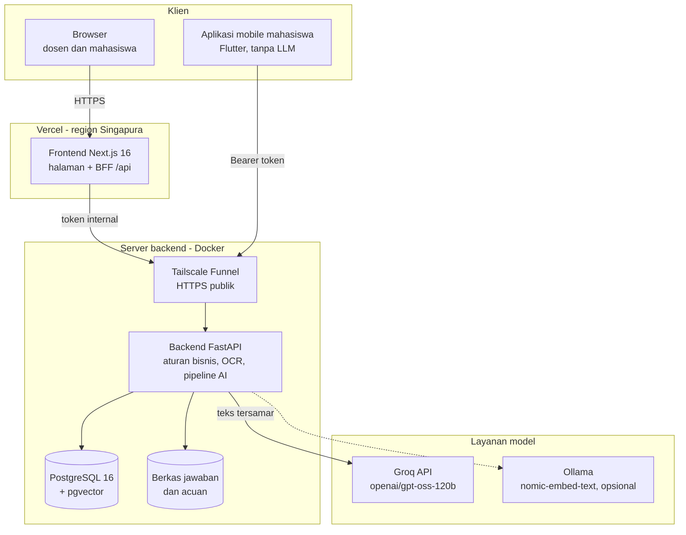

## Flowchart sistem

Gambar: `flowchart.png`

```mermaid
flowchart LR
  subgraph P1["Tahap 1 – Persiapan"]
    direction TB
    A([Mulai]) --> B[Buat kelas]
    B --> C[Susun rubrik<br/>bobot total 100%]
    C --> D[Buat tugas,<br/>tautkan rubrik]
    D --> E[Bagikan kode kelas]
  end
  subgraph P2["Tahap 2 – Pengumpulan"]
    direction TB
    E1[Gabung kelas<br/>dengan kode] --> F[Kirim jawaban:<br/>teks, PDF, DOCX, foto]
    F --> G{Terdaftar, sebelum<br/>tenggat, format valid?}
    G -- Tidak --> F1[Tolak dengan alasan]
    F1 --> F
    G -- Ya --> H[Simpan versi jawaban]
  end
  subgraph P3["Tahap 3 – Penilaian"]
    direction TB
    I[Dosen membuka jawaban] --> J{Minta draf AI?}
    J -- Ya --> K[Pipeline AI:<br/>bukti, penyamaran, model]
    K --> L{Model tersedia,<br/>respons valid?}
    L -- Ya --> N[Draf per kriteria<br/>+ kutipan bukti]
    L -- Tidak --> M1[Tanpa skor pengganti]
    J -- Tidak --> O
    N --> O[Dosen terima, ubah,<br/>atau tolak tiap kriteria]
    M1 --> O
    O --> P[Sistem hitung<br/>total berbobot]
    P --> Q[Rilis nilai]
    Q --> R[Mahasiswa melihat nilai<br/>di web atau mobile]
    R --> S([Selesai])
  end
  P1 ==> P2
  P2 ==> P3
```

## Use case diagram

Gambar: `usecase.png`

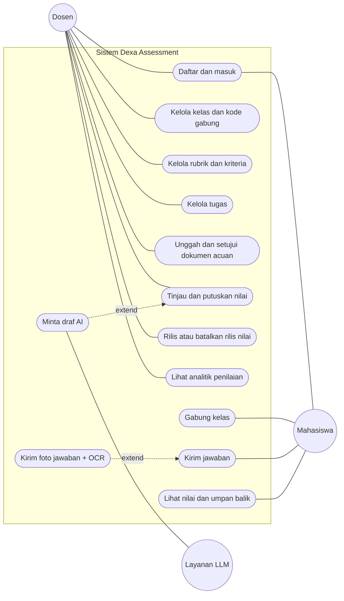

## Activity diagram: mahasiswa mengumpulkan jawaban

Gambar: `activity_kirim.png`

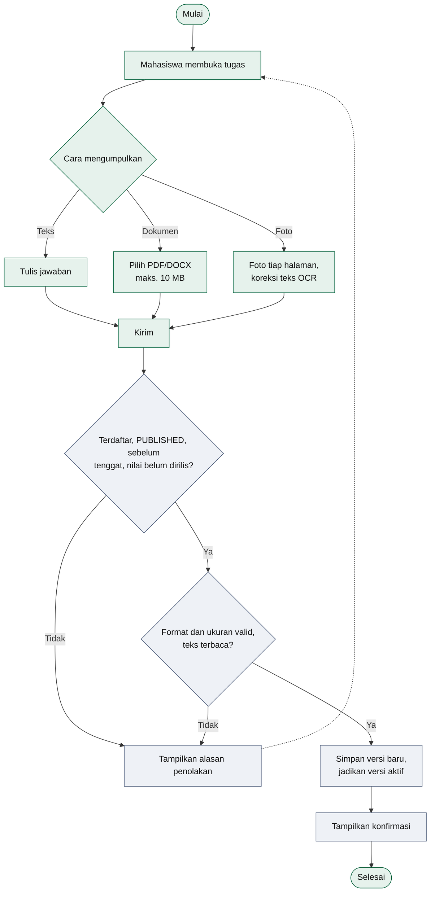

## Activity diagram: dosen menilai dengan draf AI

Gambar: `activity_nilai.png`

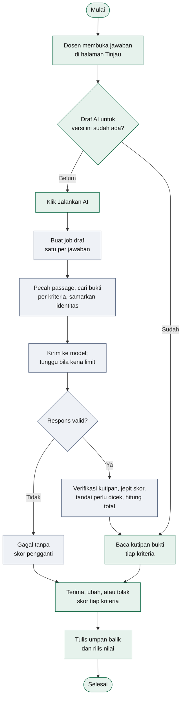

## Sequence diagram: pembuatan draf AI

Gambar: `sequence_ai.png`

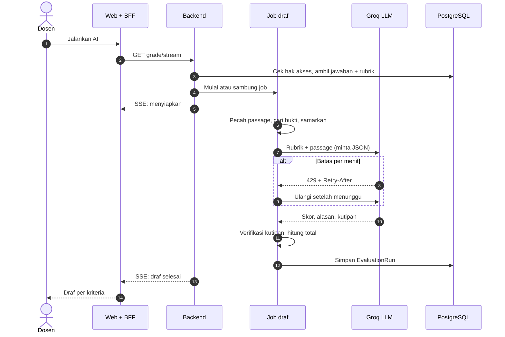

## Sequence diagram: rilis nilai

Gambar: `sequence_rilis.png`

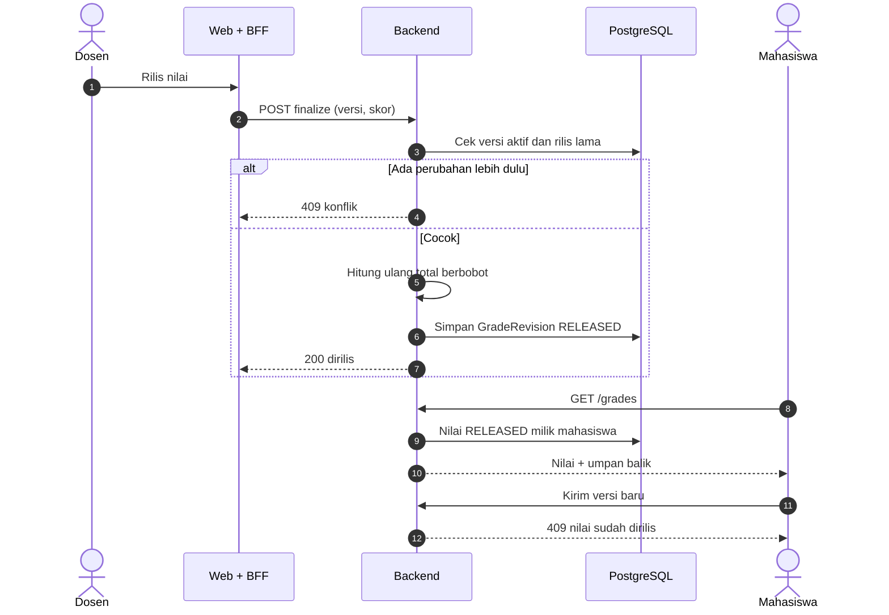

## ERD: bagian akademik

Gambar: `erd_akademik.png`

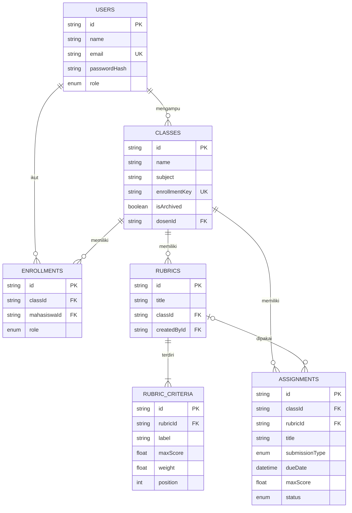

## ERD: pengumpulan, penilaian, dan dokumen acuan

Gambar: `erd_penilaian.png`

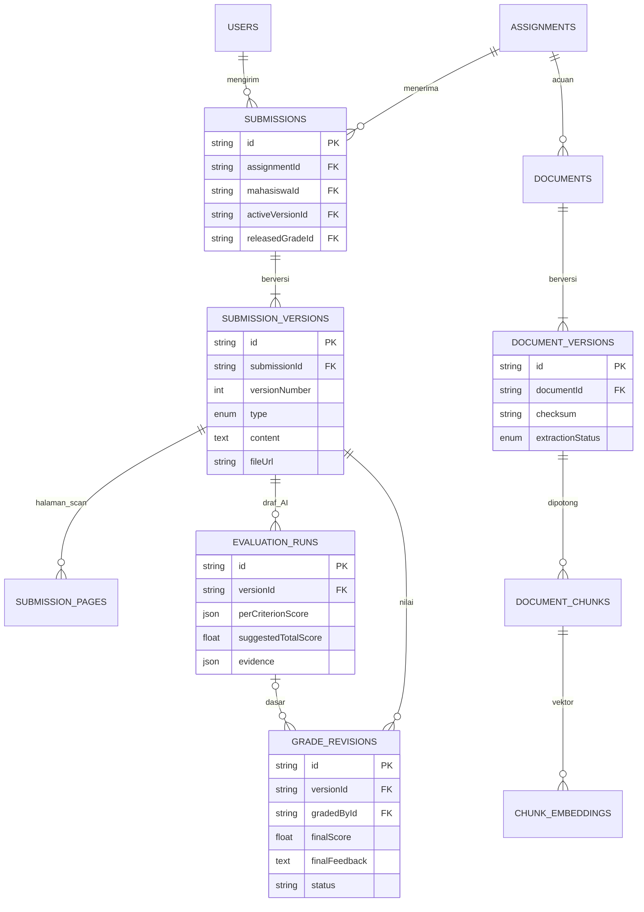

## Class diagram: model domain

Gambar: `class_domain.png`

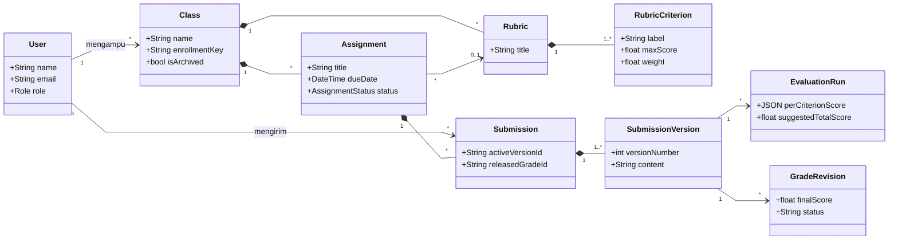

## Class diagram: layanan pipeline AI

Gambar: `class_layanan.png`

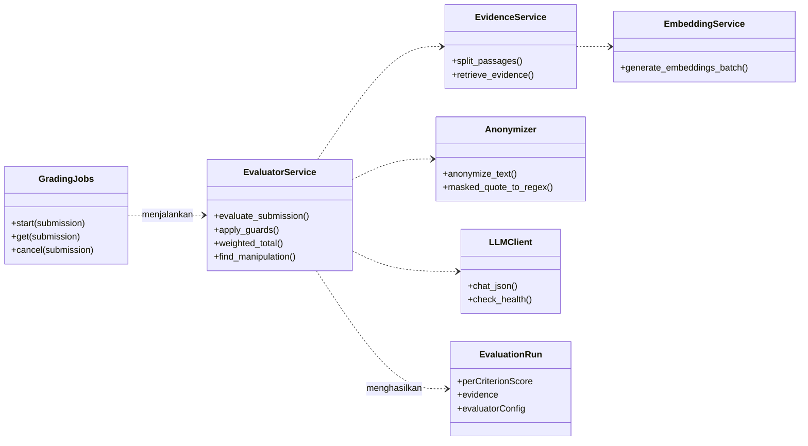
