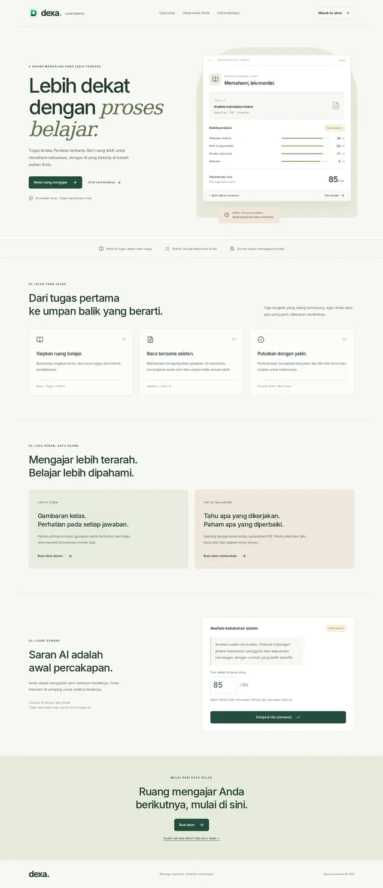
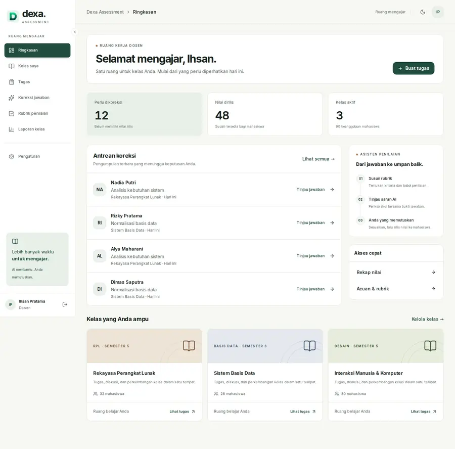
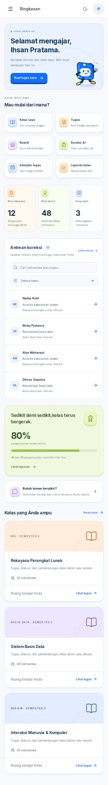
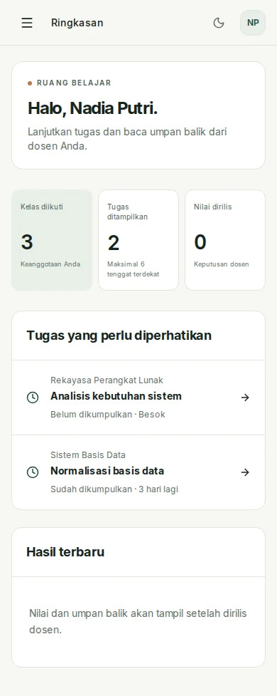
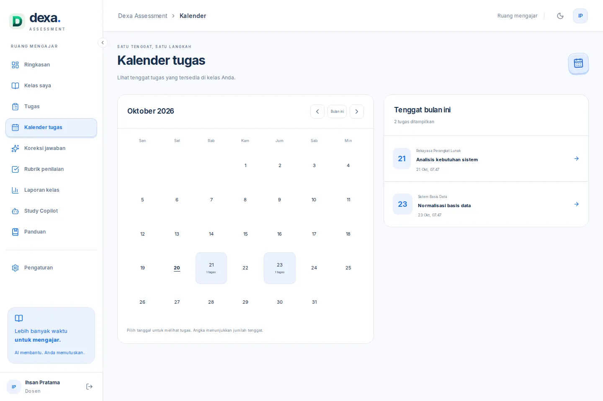
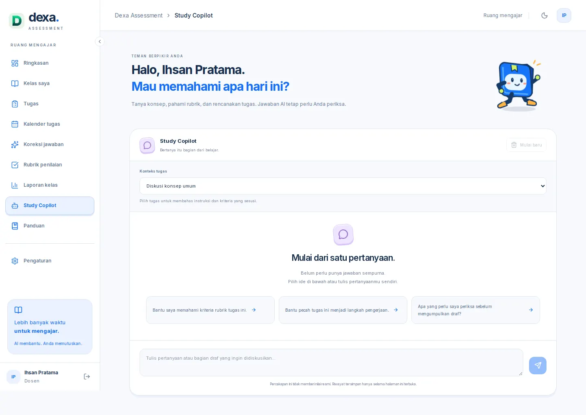
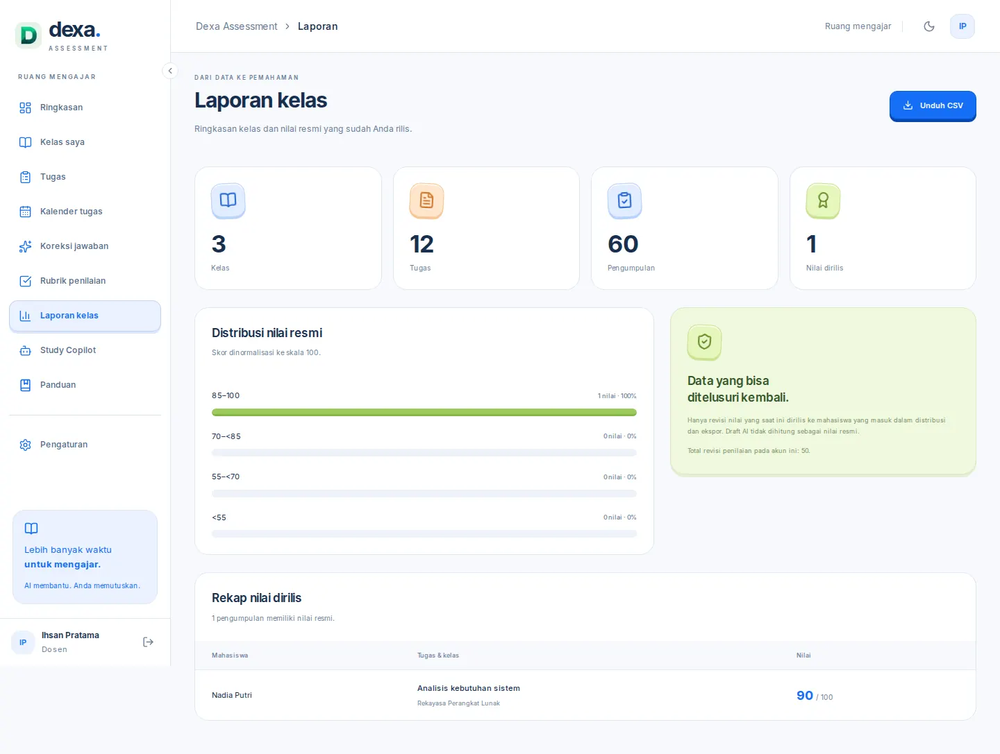

# Dexa: a more expressive learning workspace

The public landing now welcomes visitors with Dex, an original animated book companion, tactile blue/lime/peach/lilac controls, a guided tour, and a review simulation. Instructors and students have a feature hub that leads to working application routes.

[Editable Figma design](https://www.figma.com/design/istn7CpLAFlORU0IBKkZQN?node-id=20-833) · [Instructor overview](https://www.figma.com/design/istn7CpLAFlORU0IBKkZQN?node-id=2-44)

## What works

- **Landing and motion:** original SVG character with running, waving and resting poses; animated limbs, blink, shadow and floating cards. Visitors can pause animation. Reduced-motion preferences disable decorative motion. Scroll sections reveal progressively; content remains available without the observer. The interactive review demo is dynamically imported only when approaching the viewport and is explicitly labelled as a simulation.
- **Feature navigation:** classes, assignments, rubric editing, review/grading, calendar, reports, Study Copilot and guides are reachable through role-specific navigation. The previous authentication, upload, grading and class workflows remain in the existing Next.js/FastAPI project.
- **Instructor overview:** real backend counters, six feature shortcuts, searchable correction queue, class filtering and released-work progress. Data failures produce a visible error instead of invented statistics.
- **Student overview:** task filters, submitted-work progress derived from the displayed tasks, enrolled classes and released feedback. No fabricated streaks, XP or achievements.
- **Calendar:** month/day navigation and a clickable agenda using assignment due dates from authorized classes or enrollments.
- **Reports:** grade distribution and CSV export of the current released grade revision for each submission in the instructor's classes. Draft and superseded revisions are excluded. CSV fields are quoted and formula-prefixed cells escaped.
- **Study Copilot:** authenticated `/api/ai/study` → FastAPI `/ai/study`, task-context selection, suggestions, conversation reset, loading, retry and honest provider failure states. Uses configured Groq or Ollama; no canned fallback answer. Chat history is kept in the current page session only. Task access is checked server-side; the prompt contains public instructions and rubric criteria, excluding answer keys and other students' submissions. Requests have length, history, timeout and rate limits.
- **Responsive workspace:** sticky/collapsible desktop sidebar, mobile drawer, light/dark themes, keyboard-visible controls and accessible animation pause control.

## Design and Figma

The visual direction takes inspiration from Duolingo's approachable learning experience and the user's [Hua Bao Running reference](https://dribbble.com/shots/27822029-Hua-Bao-Running). Dex is an original code-native character; no external mascot, artwork or screen has been copied. Inter and installed Lucide icons keep the interface consistent. The running application is the source of truth for behavior.

Figma contains six native editable screen compositions: landing desktop/mobile, instructor desktop dashboard/classes, instructor mobile and student mobile. The shared component shelf includes buttons, navigation, course cards, the original vector mascot, tactile feature icons and shortcut variants, with Inter styles and scoped semantic variables. Figma screen content is illustrative; its mascot poses are static motion studies. The actual motion and lazy loading run in React/CSS.

## Run and verify

Use the existing project setup and environment configuration. Install `apps/backend/requirements.txt` for FastAPI. Study Copilot shares `GROQ_API_KEY`, `GROQ_BASE_URL`, `GROQ_MODEL`, or `OLLAMA_BASE_URL`/`OLLAMA_MODEL` from backend settings. A reachable configured provider is required for live answers.

Validation completed:

- Clean `npm run build:frontend` and frontend TypeScript check passed.
- `npm test`: **59 tests passed** across eight files.
- Backend pytest: **19 tests passed**, including Study access/validation, private-field exclusion, provider request contracts and current-released-revision analytics. Provider HTTP responses were mocked; live inference was not tested.
- Browser integration against the production frontend with a local fixture backend passed at 1440, 768 and 390 px: animation/pause/reduced motion, deferred demo loading, scroll reveals, role/tour actions, simulated score edit/release/reset, feature destinations, queue filters, calendar navigation, CSV download, Study API request/error/draft retention, sidebar/drawer and dark theme. No horizontal overflow or client runtime errors observed. Screenshots use fixture data, not live user records.
- Re-run UI checks after a production build with `node scripts/verify-expressive-ui.cjs`. Install Playwright Chromium first, or set `CHROMIUM_EXECUTABLE` to a compatible browser executable. The script owns local ports 3000/3001 and writes inspection captures under `/tmp`.
- Figma desktop/mobile screenshots inspected; layouts use native text/vector/frame/instance nodes instead of flattened UI images.

Existing full authentication, document extraction/upload and grading against a live database/provider were not re-exercised end to end. The PR is a draft for review; it is not deployed.

## Previews

