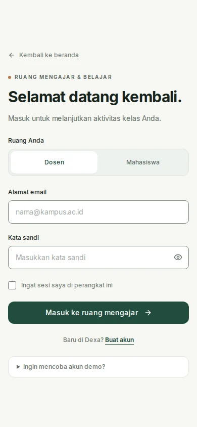

# Dexa academic workspace redesign

Dexa now presents teaching and assessment as a clear sequence: organize a class, collect answers, review recommendations, then release an instructor's decision. The implementation keeps the existing Next.js application and backend contracts.

[Figma editable design](https://www.figma.com/design/istn7CpLAFlORU0IBKkZQN?node-id=2-44)

## Implemented scope

- Marketing page with a typographic hierarchy, restrained paper/sage/clay palette, concise product copy, responsive navigation, and an explicitly labelled score-review simulation.
- Login page with real email/password authentication, demo credential filling, accessible field labels, and session controls. Removed alert-only SSO buttons and unsupported security/performance claims from the authentication showcase.
- Shared workspace navigation for desktop and mobile, a sticky desktop sidebar with collapse control, semantic theme colors, and role-specific destinations.
- Instructor and student dashboards with readable summary cards and clear next actions.
- Course cards with subject covers, member counts, working assignment links, and visible clipboard success/error feedback. Removed decorative buttons with no action.
- Four editable Figma screen compositions (teacher desktop overview, teacher desktop classes, teacher mobile overview, student mobile overview), reusable button/navigation/course components, Inter text styles, and scoped variables.

The inner grading, rubric, analytics and assignment forms keep their existing workflows and receive the shared navigation/theme. This change does not replace the backend or introduce a new site builder dependency. Figma is a design reference; the running application is the interaction source of truth. Figma sample names/counts are illustrative.

## Design references and interpretation

- [Google Classroom assignment workflows](https://developers.google.com/workspace/classroom/tutorials/assignment-workflows): organize tasks by course and keep reviewing/grading a concrete next action.
- [Duolingo's explanation of its learning path](https://blog.duolingo.com/new-duolingo-home-screen-design/): make the next step and progression clear. Dexa uses a short review sequence rather than game rewards.
- [Dribbble LMS dashboard reference collection](https://dribbble.com/search/lms-dashboard): surveyed visual hierarchy and card density; no external screen or brand assets were copied.

The UI uses the repository's own logo, Inter, and installed Lucide icons. Serif emphasis is confined to the public landing headline; workspaces use Inter throughout.

## Verification

- `npm run build:frontend` — passed a clean production build.
- `npm run typecheck -w apps/frontend` — passed.
- `npm test` — 59 tests across 8 files passed.
- Biome checks on the 10 changed TSX files — no errors; one existing `any[]` warning in the classes page.
- Playwright against the production frontend with a local HTTP fixture backend: passed at desktop (1440 px), tablet (768 px), and phone (390 px). Checked horizontal overflow, both dashboard roles, landing menu closure, mobile drawer navigation, sidebar position/collapse, dark theme, class assignment destinations, demo account filling, and simulated score edit/release/reset. No client runtime errors observed.
- Screenshots below were rendered from the production frontend with illustrative fixture data; they are not screenshots of live user records. Full authentication, upload and AI grading integration against the real FastAPI service was not run in this environment.
- Figma screenshots inspected; heading reflow, card widths, active icons and Inter font use verified. All four screens contain native text/vector/frame/instance nodes; no flattened UI screenshots.

## Previews

